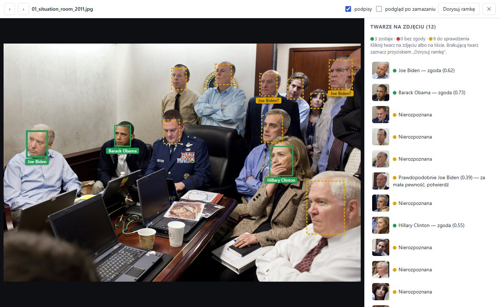
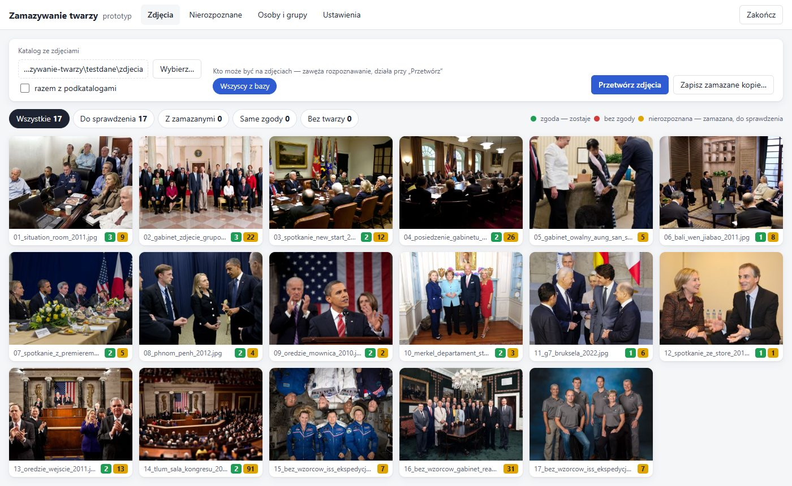

# Zamazywanie twarzy — prototyp

Lokalna aplikacja, która rozpoznaje na zdjęciach osoby z bazy i **zamazuje wszystkich poza osobami ze zgodą**
(tryb „dozwolonych twarzy”). Działa w całości na komputerze, bez internetu i bez karty graficznej.
Interfejs otwiera się w przeglądarce, a pod spodem działa lokalny serwer (.NET 10).

## Jak to wygląda

Zielone ramki — osoby ze zgodą (zostają), żółte — nierozpoznane (zostaną zamazane). Pod ramką imię rozpoznanej osoby,
ze znakiem „?”, gdy to tylko podpowiedź do potwierdzenia:



„Podgląd po zamazaniu” — tak będzie wyglądać zapisana kopia (lista twarzy po prawej to widok dla obsługującego program):


Siatka przetworzonych zdjęć z liczbą twarzy w każdym kolorze:



<sub>Zdjęcia: Biały Dom, Departament Stanu, NASA i inne — domena publiczna, Wikimedia Commons (źródła w
`testdane/ZRODLA.md`). Wzorce osób ze zgodą w tym przykładzie: B. Obama, J. Biden, H. Clinton.</sub>

## Pobranie

Najnowsza wersja dla Windows 10/11 x64 (bez instalowania .NET):
**[ZamazywanieTwarzy-win-x64.zip](https://github.com/Albertll/ZamazywanieTwarzy/releases/latest/download/ZamazywanieTwarzy-win-x64.zip)**
— rozpakuj i uruchom `ZamazywanieTwarzy.exe`. Plik nie jest podpisany, więc Windows SmartScreen może ostrzec przy
pierwszym uruchomieniu („Więcej informacji” → „Uruchom mimo to”).

Wydania buduje GitHub Actions (`.github/workflows/build.yml`): każdy push na `main` sprawdza build i zostawia ZIP
jako artefakt przebiegu, a wypchnięcie taga `v*` (np. `git tag v0.2 && git push origin v0.2`) tworzy nowe wydanie —
link powyżej zawsze wskazuje najnowsze.

## Uruchomienie

Z repozytorium: `dotnet run --project src\ZamazywanieTwarzy` (wymaga .NET 10 SDK) albo zbuduj wersję
„jeden plik, bez instalowania .NET” (sekcja *Budowanie*) — powstaje `publikacja\ZamazywanieTwarzy.exe`, obok którego
muszą leżeć katalogi `modele` i `wwwroot`. Program otwiera przeglądarkę sam. Okno konsoli to serwer: jego zamknięcie albo przycisk „Zakończ” wyłącza program.

Dane programu (osoby, zgody, decyzje, wycinki twarzy, miniatury) trafiają do `dane\` obok pliku .exe.
Inne miejsce: `ZamazywanieTwarzy.exe --dane D:\Zaszyfrowany\dane`. Wektorów cech twarzy (danych biometrycznych) program
nie zapisuje — patrz [Dane osobowe i biometria](#dane-osobowe-i-biometria). Wycinki i miniatury to jednak zdjęcia twarzy,
więc katalog danych warto trzymać na zaszyfrowanym dysku (program sam bazy nie szyfruje).

Szybka próba na zdjęciach testowych (domena publiczna / CC — autorzy i licencje w `testdane\ZRODLA.md`;
zdjęć nie ma w repozytorium):
0. `powershell -ExecutionPolicy Bypass -File testdane\pobierz.ps1` — pobiera 32 zdjęcia (55 MB) z Wikimedia Commons.
1. *Osoby i grupy* → **Import wzorców z katalogu…** → `testdane\wzorce`, zaznacz „mają zgodę”.
2. *Zdjęcia* → **Wybierz…** → `testdane\zdjecia` → **Przetwórz zdjęcia**.
3. Kliknij zdjęcie, sprawdź żółte twarze, potem **Zapisz zamazane kopie…**.

## Jak to działa

| Kolor | Znaczenie | W kopii |
|---|---|---|
| 🟢 zielony | osoba ze ważną zgodą — rozpoznana z dużą pewnością albo przypisana ręcznie | zostaje |
| 🔴 czerwony | osoba bez zgody (lub zgoda wygasła), ramka dorysowana ręcznie, „zamazuj zawsze” | zamazana |
| 🟡 żółty | nierozpoznana albo „prawdopodobnie X”, ale za mała pewność | zamazana, do sprawdzenia |
| ⚪ szary | oznaczona ręcznie jako „to nie twarz” | bez zmian |

Zasada: **każda wątpliwość = zamazanie.** Automatyczne „zielone” wymaga jednocześnie:
- podobieństwa ≥ 0,50 (*próg „zielonego”*),
- przewagi ≥ 0,05 nad drugą najbardziej podobną osobą (rodzeństwo, sobowtóry),
- zgodności z co najmniej dwoma wzorcami osoby (jeśli ma ich ≥ 2).

Kliknięcie twarzy pozwala przypisać ją do osoby (z podpowiedzią 3 najbardziej podobnych), dodać nową osobę,
oznaczyć „to nie twarz” albo „zamazuj zawsze”. Przypisana twarz domyślnie trafia do wzorców osoby — program
uczy się w trakcie pracy i od razu ponownie dopasowuje wszystkie pozostałe twarze.
**Dorysuj ramkę** służy do twarzy, której program nie znalazł — to jedyna obrona przed przeoczeniem.

**Podpisy** (przełącznik w podglądzie zdjęcia): pod ramką rozpoznanej osoby jej imię i nazwisko w kolorze ramki,
„Imię Nazwisko?” dla żółtej z podpowiedzią; nierozpoznanych się nie podpisuje. Kliknięcie podpisu zaznacza twarz,
a nachodzące na siebie podpisy na zdjęciach grupowych są rozsuwane. Podpisy są tylko w programie — **zapisywane kopie
ich nie zawierają**.

Pozostałe funkcje:
- **Grupy** (klasa, chór, kadra; osoba może być w kilku). Przy przetwarzaniu można wybrać, kto może być na zdjęciach —
  twarze są wtedy porównywane tylko z tymi osobami (mniej pomyłek). Grupę można zarchiwizować po roku szkolnym.
- **Import listy z CSV** (`imię; nazwisko; grupy; zgoda; zgoda ważna do`) — także plik z polskiego Excela (Windows-1250).
- **Zgoda z datą ważności** — po tej dacie osoba sama zmienia się na czerwoną.
- **Ostrzeżenie „stare wzorce”** — gdy najnowsze zdjęcie wzorcowe ma ponad 12 miesięcy (twarze dzieci szybko się zmieniają).
  Wiek wzorca brany jest z EXIF (data zrobienia), a gdy go brak — z daty modyfikacji pliku.
- **Nierozpoznane** — żółte twarze zebrane w grupy podobnych; przypisanie całej grupy jednym kliknięciem.
- **Zapis kopii** do osobnego katalogu (oryginały nietknięte), bez EXIF (GPS, miniatury), plus `raport.csv`.
  Zdjęcie zmienione po przetworzeniu nie zostanie zapisane, dopóki nie przetworzysz go ponownie.

## Dane osobowe i biometria

Dwa tryby pracy do wyboru w *Ustawieniach*:

| | Z rozpoznawaniem (domyślny) | Bez rozpoznawania |
|---|---|---|
| Jak działa | porównuje twarze ze wzorcami osób i sam odsłania osoby ze zgodą | tylko znajduje twarze i zamazuje wszystkie; osoby ze zgodą odsłania operator, przypisując je z listy |
| Wektory cech twarzy (dane biometryczne) | **tylko w pamięci RAM**, póki program działa — nigdy na dysku | nie powstają |
| Na dysku | wyrównany wycinek twarzy 112×112 (JPEG), z którego po starcie liczy się wektory od nowa (kilka sekund przy kilkuset twarzach) | wycinek do podglądu na liście |
| Porównywanie twarzy osób bez zgody | tak — żeby stwierdzić, że ktoś *nie* jest na liście | nie |

- Przejście na tryb bez rozpoznawania usuwa wzorce twarzy, wycinki do porównywania i automatyczne dopasowania
  (osoby, grupy, zgody i ręczne decyzje zostają). Powrót odtwarza wycinki z zapisanych punktów twarzy; wzorce trzeba dodać od nowa.
- **Usuń dane katalogu…** (zakładka *Zdjęcia*) — po zakończeniu pracy usuwa wszystko o zdjęciach z katalogu: twarze
  z wycinkami, decyzje, miniatury i podglądy. Baza zeruje kasowane rekordy (`secure_delete`) i jest od razu odchudzana
  (`VACUUM`), więc usunięte dane nie zostają w pliku.
- Baza z wersji 0.1 (wektory zapisane na dysku) jest przy pierwszym uruchomieniu przerabiana automatycznie: kolumny
  z wektorami są usuwane, a wycinki odtwarzane ze zdjęć.

**Nieprzechowywanie to nie to samo co nieprzetwarzanie.** W trybie z rozpoznawaniem program liczy i porównuje wektor
każdej twarzy, także dziecka bez zgody. Europejska Rada Ochrony Danych w wytycznych 3/2019 opisuje analogiczny przykład
(hotel rozpoznający gości VIP, którzy wyrazili zgodę) i wskazuje, że takie przetwarzanie wymaga podstawy prawnej także
wobec pozostałych osób. Wybór trybu w szkole, przedszkolu czy klubie to decyzja dla inspektora ochrony danych, nie dla programu.

## Wyniki na zdjęciach testowych (dorośli, 17 zdjęć, 272 twarze)

- Czas: 17 zdjęć 2600–4096 px w ~12 s (3 zdjęcia równolegle, procesor bez GPU).
- **Żadnej obcej osoby nie odsłonięto.** Najwyższe podobieństwo obcej osoby do wzorca: 0,448; najniższe właściwej
  osoby en face: 0,513. Stąd domyślny próg „zielonego” 0,50.
- 25 z 27 wystąpień osób ze wzorców rozpoznanych automatycznie; 2 twarze z profilu zostały żółte (do potwierdzenia).
- Na zdjęciach bez osób ze wzorców (astronauci, gabinet Reagana) — 0 zielonych.
- Po jednym ręcznym przypisaniu nowej osoby program sam rozpoznał ją na innym zdjęciu.

**To dane dla dorosłych z publicznych zdjęć.** Dla dzieci rozpoznawanie będzie słabsze (modele uczone głównie na
dorosłych, rodzeństwo, szybkie zmiany twarzy) — przed użyciem trzeba sprawdzić skuteczność na własnych zdjęciach
i ewentualnie podnieść próg „zielonego” w *Ustawieniach*.

## Znane ograniczenia prototypu

- **Przeoczone twarze nie są zamazywane.** Na zdjęciu tłumu (`14_tlum_sala_kongresu`) nie wykryto drobnych,
  optycznie rozmytych twarzy na galerii. Przed publikacją trzeba przejrzeć „podgląd po zamazaniu” i dorysować brakujące.
- Fałszywe wykrycia (tył głowy, oparcie krzesła) są zamazywane — nieszkodliwe, ale zaśmiecają listę „Nierozpoznane”.
- Bardzo małe, nieostre twarze bywają do siebie podobne niezależnie od osoby, więc grupy w „Nierozpoznanych” warto przejrzeć
  przed przypisaniem (kliknięcie miniatury ją odznacza).
- Nie ma zakresów zgody (np. „strona www tak, Facebook nie”), cofania zmian ani kont użytkowników.
- Formaty: JPG, PNG, WEBP, BMP (bez HEIC z iPhone'a).

## Budowanie

Projekt: `src\ZamazywanieTwarzy` (.NET 10, ASP.NET Core minimal API, ONNX Runtime 1.31, SkiaSharp 4, SQLite).

```
dotnet run --project src\ZamazywanieTwarzy
dotnet publish src\ZamazywanieTwarzy -c Release -r win-x64 --self-contained -p:PublishSingleFile=true ^
  -p:IncludeNativeLibrariesForSelfExtract=true -p:EnableCompressionInSingleFile=true -p:DebugType=none -o publikacja
```

| Plik | Rola |
|---|---|
| `Detektor.cs` | YuNet: kafelki 640×640 w 3 skalach (duże twarze / typowe / małe w tle), scalanie NMS |
| `Rozpoznawanie.cs` | SFace: wyrównanie twarzy wg 5 punktów do 112×112, wektor 128 cech (liczony zawsze z zapisanego wycinka) |
| `Zamazywanie.cs` | owal z zapasem, zmniejszenie do kilku pikseli + rozmycie (nieodwracalne) |
| `Silnik.cs` | przetwarzanie, wektory cech w pamięci, dopasowanie do osób, reguły kolorów, tryby, import, zapis kopii, sprzątanie |
| `Baza.cs` | SQLite: osoby, grupy, wzorce, zdjęcia, twarze |
| `Program.cs`, `Api.cs` | serwer na 127.0.0.1, losowy klucz w adresie, API dla interfejsu |
| `wwwroot\` | interfejs (HTML/CSS/JS bez bibliotek) |

Bezpieczeństwo serwera: nasłuch tylko na 127.0.0.1, losowy klucz w adresie otwieranym przy starcie (ciasteczko
`SameSite=Strict`), sprawdzanie nagłówka `Host` (ochrona przed DNS rebinding) i własny nagłówek przy zmianach (CSRF).

Testy: `proba\pw\ui-test.js` (przeklikanie ekranów), `proba\pw\ui-akcje.js` (przypisanie, nowa osoba, „to nie twarz”,
dorysowanie ramki, import CSV w Windows-1250, zapis kopii), `ui-podpisy.js` i `ui-tryby.js` (tryb bez rozpoznawania,
powrót, „Usuń dane katalogu”) — Edge przez playwright-core, serwer z `ZAMAZYWANIE_TOKEN`
i `--port 5077`. Zrzuty ekranu: `proba\zrzuty\`.

## Licencje modeli

- YuNet `face_detection_yunet_2023mar.onnx` — OpenCV Zoo, **MIT**.
- SFace `face_recognition_sface_2021dec.onnx` — OpenCV Zoo, plik na licencji **Apache 2.0**, ale **dane treningowe nie są
  udokumentowane**. Oryginalna praca o SFace używa zbiorów CASIA-WebFace, VGGFace2 i MS1MV2, które dopuszczają tylko
  użycie badawcze. Pytanie o dane i użycie komercyjne jest otwarte w
  [opencv_zoo #313](https://github.com/opencv/opencv_zoo/issues/313) (od lipca 2026, bez odpowiedzi opiekunów).
  Przy użyciu komercyjnym albo instytucjonalnym to ryzyko trzeba ocenić samodzielnie.

Modele InsightFace (SCRFD, ArcFace) są wyraźnie lepsze, ale ich wagi wolno używać tylko do **niekomercyjnych badań** —
także „niekomercyjny” projekt praktyczny (np. szkoła) wymaga licencji od InsightFace. Program ich nie zawiera.
Teksty licencji i źródła: `src\ZamazywanieTwarzy\modele\` (kopiowane też do wersji opublikowanej).

## Porównanie modeli

Narzędzie `proba\porownanie` mierzy modele na zdjęciach testowych (`dotnet run --project proba\porownanie -c Release`,
modele spoza programu w `proba\modele-porownanie`). Wyniki z 29.10.2026 — szczegóły w
[`proba/porownanie/WYNIKI.md`](proba/porownanie/WYNIKI.md):

- **Rozpoznawanie** (27 wystąpień 3 dorosłych osób publicznych): SFace i ArcFace R50 (InsightFace) wskazały właściwą osobę
  we wszystkich 27 przypadkach. ArcFace ma jednak dużo większy zapas bezpieczeństwa: najsłabsza właściwa osoba 0,42 przy
  najwyższym wyniku osoby obcej 0,25, podczas gdy w SFace 0,434 wobec 0,427 (rozdzielenie d′ 6,3 wobec 4,9). Kosztem jest
  ok. 4× dłuższe liczenie. Przy dzieciach ten zapas miałby większe znaczenie.
- **Wykrywanie:** SCRFD-10G (InsightFace) znalazł kilka prawdziwych twarzy, które YuNet pominął (częściowo zasłonięte,
  ucięte krawędzią kadru, rozmyte w tłumie), i nie dał ok. 35 fałszywych ramek YuNet (tyły głów, dłonie, przedmioty) —
  ale też pominął dwie twarze, które YuNet znalazł, i jest ok. 4,5× wolniejszy.
- **Obniżenie progu YuNet z 0,6 do 0,5** (bez zmiany modelu): +40 ramek, wśród nich kilka wyraźnych twarzy, które przy 0,6
  zostałyby odsłonięte (m.in. twarz en face 51 px), kilkanaście rozmytych twarzy z tłumu i ok. 20 fałszywych ramek
  (nieszkodliwych — kończą się zbędnym zamazaniem). **Od v0.2 domyślny próg to 0,5.** Instalacja z zapisanym starym
  domyślnym 0,6 przechodzi na 0,5 sama; wartość ustawioną świadomie w v0.2 program zostawia.

Zmiana czułości wykrywania działa także dla przetworzonych już zdjęć: program pamięta, z jakimi ustawieniami wykrył
twarze, i przy „Przetwórz zdjęcia” wykrywa je na nowo, przenosząc decyzje operatora (przypisania, „to nie twarz”,
„zamazuj zawsze”) na ramki w tym samym miejscu. Decyzja bez odpowiednika w nowym wykryciu zostaje ze starą ramką,
a ramki dorysowane ręcznie nie są ruszane.

Zbiór jest mały (dorośli, zdjęcia z mediów), więc wyniki są orientacyjne. AuraFace (Apache 2.0, wytrenowany na danych
dopuszczonych komercyjnie) narzędzie dołączy samo, gdy plik `glintr100.onnx` z
[fal/AuraFace-v1](https://huggingface.co/fal/AuraFace-v1) trafi do `proba\modele-porownanie\auraface_glintr100.onnx`.
Uwaga: pozostałe pliki w tamtym repozytorium (m.in. `scrfd_10g_bnkps.onnx`) są bajt w bajt plikami InsightFace.
